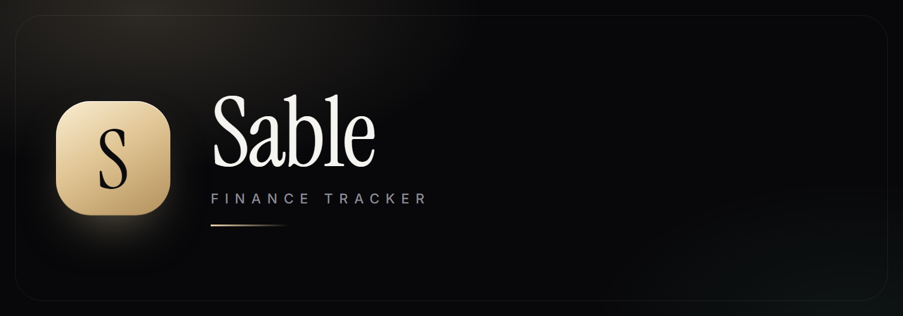
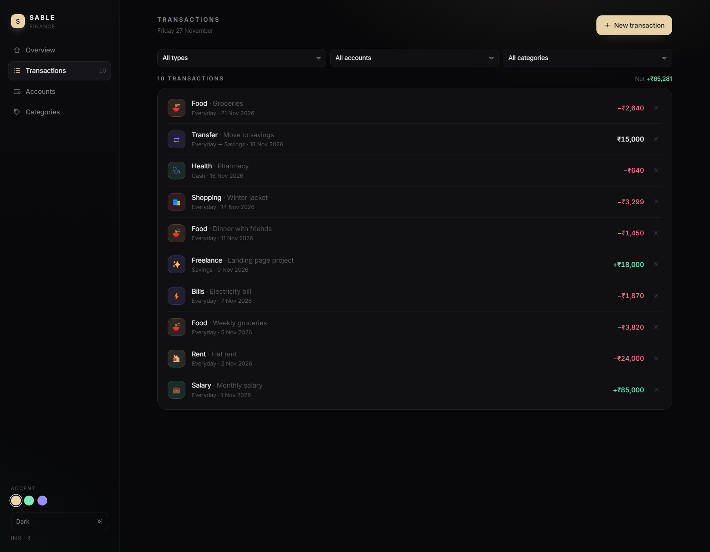

<p align="center">
  
</p>

<p align="center">
  A black, minimal personal finance tracker for income, expenses, transfers and accounts.<br>
  Desktop app for Windows and Mac. No account, no cloud, no tracking — your data stays on your computer.
</p>

## Screenshots

<p align="center">
  
</p>

<p align="center"><sub><b>Overview</b> — total balance, this month's income, spending and savings, every account, and where the money went by category.</sub></p>

<p align="center">
  
</p>

<p align="center"><sub><b>Transactions</b> — the full log, filterable by type, account or category, with a running net for whatever you are looking at.</sub></p>

## Download

Go to **[Releases](../../releases/latest)** and pick your file:

| Platform | File |
|---|---|
| Windows | `Sable-Setup-<version>.exe` |
| Mac (Apple Silicon) | `Sable-<version>-arm64.dmg` |
| Mac (Intel) | `Sable-<version>-x64.dmg` |

The installers are not code-signed, so Windows and Mac show a warning the first time:

- **Windows:** "Windows protected your PC" → *More info* → *Run anyway*
- **Mac:** right-click the app → *Open* → *Open*, or in Terminal: `xattr -cr /Applications/Sable.app`

## What it does

- **Overview** — total balance, this month's income / spent / saved, account cards, spending by category, recent transactions
- **Transactions** — full log with filters for type, account and category
- **Accounts** — one per bank, wallet or card, each with its own opening balance, colour and full log
- **Categories** — custom expense and income categories with emoji and colour, each with its own log
- **Add transaction** — Expense, Income or Transfer in one sheet
- **Themes** — black by default, light mode, and three accent colours (champagne, jade, iris)
- Currency is Indian Rupee (₹ / INR)

Balance of an account = opening balance + income − expenses − transfers out + transfers in.

## Run it yourself

Requires [Node.js](https://nodejs.org).

```
npm install
npm start
```

If Electron's installer script is blocked during `npm install`, run:

```
node node_modules/electron/install.js
npm start
```

## Build an installer

```
npm run dist:win     # Windows .exe
npm run dist:mac     # Mac .dmg (must be run on a Mac)
```

If Windows complains about symbolic links while building, turn on **Developer Mode**
(Settings → System → For developers) and retry.

## Releasing a new version

1. Change `"version"` in `package.json` (e.g. `1.1.0`).
2. Create a GitHub Release with tag `v1.1.0`.
3. The workflow in `.github/workflows/release.yml` builds the installers and attaches them automatically.

Repo setting needed once: **Settings → Actions → General → Workflow permissions → Read and write permissions**.

## How it is built

One `index.html` with inline CSS and vanilla JavaScript, wrapped in Electron by `main.js`.
No framework, no build step, no server. Data is stored in `localStorage` under the key `sable-v1`.

```
Sable/
├── .github/workflows/release.yml
├── assets/          logo, icon and screenshots
├── index.html       the entire app
├── main.js          Electron window
├── package.json     app + installer config
└── README.md
```

## Roadmap

### v1.1 — Edit and find
- Edit / duplicate an existing transaction
- Month selector on the Overview
- Search transactions by note or amount

### v1.2 — Real bank data
- CSV statement import into an account
- JSON backup / export / restore

### v1.3 — Budgets and trends
- Monthly budget per category with progress
- 12-month income vs spending chart

### v1.4 — Automation
- Recurring transactions
- Upcoming bills with a countdown

### v2.0 — The bigger app
- Multi-currency accounts
- Savings goals
- Custom app icon and signed installers

## License

MIT
