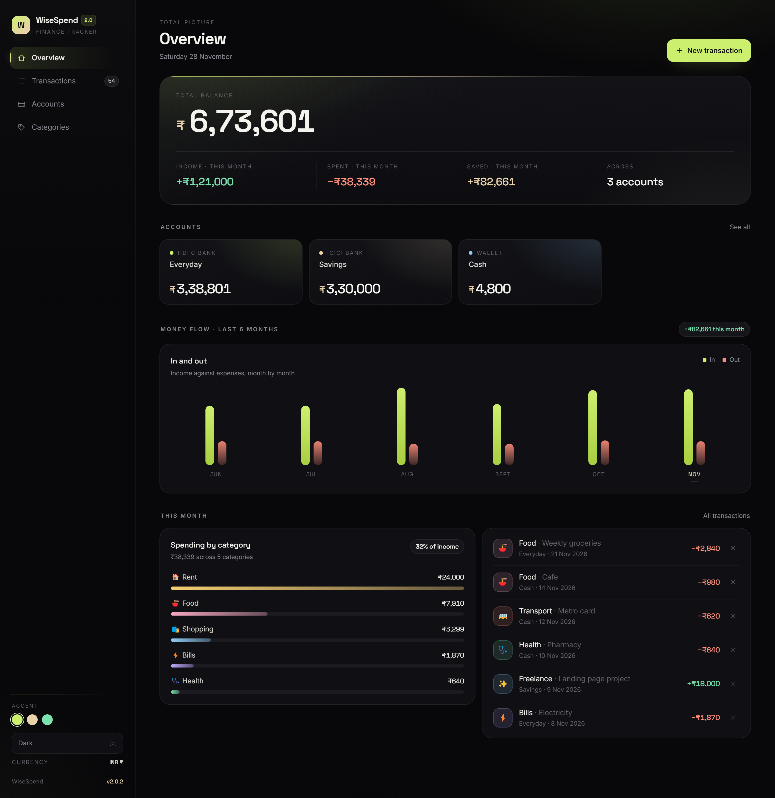
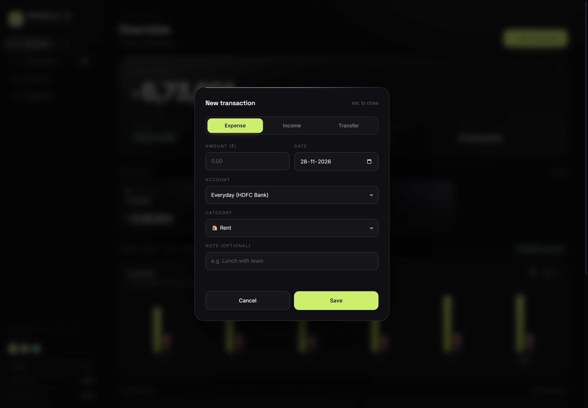

<p align="center">
  
</p>

<p align="center">
  A premium, minimalist personal finance tracker for income, expenses, transfers and accounts.<br>
  Black interface, lime accent, champagne gold details. Desktop app for Windows and Mac.<br>
  No account, no cloud, no tracking — your data stays on your computer.
</p>

<p align="center">
  <sub><b>Version 2.0.2</b> · previously released as <b>Sable</b></sub>
</p>

---

## Screenshots

<p align="center">
  
</p>

<p align="center"><sub><b>Overview</b> — total balance, this month's income, spending and savings, every account, six months of money in and out, and where the money went.</sub></p>

<p align="center">
  
</p>

<p align="center"><sub><b>Transactions</b> — the full log, filterable by type, account or category, with a running net for whatever you are looking at.</sub></p>

<p align="center">
  
</p>

<p align="center"><sub><b>Accounts</b> — one card per bank, wallet or card, each with its own accent and balance.</sub></p>

<p align="center">
  
</p>

<p align="center"><sub><b>Add transaction</b> — Expense, Income or Transfer in one focused sheet.</sub></p>

<p align="center">
  
</p>

<p align="center"><sub><b>Categories</b> — custom expense and income categories with emoji and colour, each with its own log.</sub></p>

## Design system

WiseSpend 2.0 is built from a small, fixed set of tokens. Nothing in the app uses a colour outside this list.

### Colour

| Token | Value | Used for |
|---|---|---|
| Main background | `#08080A` | App canvas |
| Soft background | `#0B0B0E` | Recessed areas, light-theme hints |
| Surface · primary | `#101014` | Cards and panels |
| Surface · secondary | `#15151A` | Inputs, filter chips, hovered rows |
| Surface · raised | `#1B1B21` | Tracks, pressed states, badges |
| Border · subtle | `rgba(255,255,255,.075)` | Card and section borders |
| Border · strong | `rgba(255,255,255,.14)` | Inputs, buttons, sheet edge |
| Text · primary | `#F4F3EE` | Headings and amounts |
| Text · secondary | `#D6D5CE` | Row titles, secondary figures |
| Text · muted | `#8B8A93` | Labels, navigation, captions |
| Text · faint | `#65646D` | Metadata, timestamps, emoji-free hints |
| Lime · primary | `#CDEF6E` | Primary buttons, active navigation, focus, highlights |
| Lime · deep | `#A9CE3F` | Gradient end of lime fills and bars |
| Jade | `#79E2AF` | Income, positive values |
| Coral | `#FF8F7B` | Expenses, destructive actions, errors |
| Lilac | `#BCA9FF` | Transfers |
| Amber | `#F5CE73` | Category accent |
| Sky | `#8FCDF5` | Category accent |
| Rose | `#F5A8C0` | Category accent |
| Champagne gold · heritage | `#E8D3A9` | Savings, brand gradient, legacy accent |
| Text on lime | `#0A0A0B` | Labels on primary buttons |

Colour is never decorative: jade always means money in, coral always means money out, lilac always means a transfer, and gold always means money kept.

### Typography

| Role | Font | Weights | Notes |
|---|---|---|---|
| Display | **Space Grotesk** | 400 / 500 / 600 / 700 | Page headings, balances, statistics, account figures, amounts |
| Body | **Inter** | 400 / 500 / 600 | Navigation, labels, notes, inputs |

- Page heading: Space Grotesk 600, 30px, `-0.028em`.
- Hero balance: Space Grotesk 600, 58px, `-0.035em`, tabular figures, small muted `₹` prefix.
- Statistics and KPI values: Space Grotesk 500, 20px, tabular figures.
- Eyebrow labels: Inter 600, 10px, `0.19em`, uppercase, faint.

### Shape, depth and motion

- Radii: `26px` hero, `20px` cards, `16px` account and icon tiles, `11px` inputs.
- One-pixel borders at 7.5% white; elevation comes from surface contrast, not heavy shadows.
- Hero has a lime-to-gold hairline along its top edge and two restrained radial washes (lime top-left, gold bottom-right).
- Transitions are 160–180ms; hover lifts cards by 2px; charts animate width/height over 400ms.

### The gold thread

1.x was champagne gold on black. 2.0 keeps that identity as a second voice rather than dropping it:
the brand mark is a lime-to-gold gradient, the hero hairline fades lime into gold, "Saved this month" is
rendered in gold, the Savings account glows gold, and the accent switch still offers **Gold** (champagne)
alongside **Lime** and **Jade**.

## What it does

- **Overview** — total balance, this month's income / spent / saved, account cards, six-month money-in-and-out chart, spending by category, recent transactions
- **Transactions** — full log with filters for type, account and category, plus the net for the current filter
- **Accounts** — one per bank, wallet or card, each with its own opening balance, colour and full log
- **Categories** — custom expense and income categories with emoji and colour, each with its own log
- **Add transaction** — Expense, Income or Transfer in one sheet
- **Themes** — black by default, light mode, and three accent colours (lime, gold, jade)
- Currency is Indian Rupee (₹ / INR)

Balance of an account = opening balance + income − expenses − transfers out + transfers in.

## Upgrading from Sable

WiseSpend used to be Sable, and renaming an Electron app moves the folder it keeps its data in
(`%APPDATA%/Sable` on Windows, `~/Library/Application Support/Sable` on macOS). 2.0.1 fixes that: on the
first launch, WiseSpend reads the Sable store through a throwaway profile and adopts it.

- A fresh WiseSpend profile is **replaced** with your Sable accounts, categories, transactions and accent.
- A profile that already has entries (for example something you added in 2.0.0) is **merged** by id, so
  nothing is duplicated and nothing is deleted.
- The imported store is staged as `sable-recovered.json` in the WiseSpend data folder; a
  `.legacy-store-checked` marker makes the migration a one-time step.
- The 1.x champagne accent preference carries over as the **Gold** accent.
- On launch the Overview shows a one-time "Recovered from Sable" note with what was carried over.
- Your Sable installation is left untouched — uninstall it once you have checked that your numbers are there.

## Download

Go to **[Releases](../../releases/latest)** and pick your file:

| Platform | File |
|---|---|
| Windows | `WiseSpend-Setup-<version>.exe` |
| Mac (Apple Silicon) | `WiseSpend-<version>-arm64.dmg` |
| Mac (Intel) | `WiseSpend-<version>-x64.dmg` |

The installers are not code-signed, so Windows and Mac show a warning the first time:

- **Windows:** "Windows protected your PC" → *More info* → *Run anyway*
- **Mac:** right-click the app → *Open* → *Open*, or in Terminal: `xattr -cr /Applications/WiseSpend.app`

## Run it yourself

Requires [Node.js](https://nodejs.org).

```
npm install
npm start
```

If Electron's installer script is blocked during `npm install`, run:

```
node node_modules/electron/install.js
npm start
```

## Build an installer

```
npm run dist:win     # Windows .exe
npm run dist:mac     # Mac .dmg (must be run on a Mac)
```

If Windows complains about symbolic links while building, turn on **Developer Mode**
(Settings → System → For developers) and retry.

## Releasing a new version

1. Change `"version"` in `package.json` (e.g. `2.1.0`).
2. Create a GitHub Release with tag `v2.1.0`.
3. The workflow in `.github/workflows/release.yml` builds the installers and attaches them automatically.

Repo setting needed once: **Settings → Actions → General → Workflow permissions → Read and write permissions**.

## What changed in 2.0

### 2.0.2

- Fixed the **Got it** button on the recovery banner, which did nothing, so the note could not be dismissed.

### 2.0.1

- The app is now **WiseSpend** in name as well as design: `com.wisespend.finance`, `WiseSpend-Setup-*.exe`,
  `WiseSpend-*.dmg`, and the repository is `innovation-workslmt/WiseSpend`.
- The version is visible in the app: `WiseSpend v2.0.2` at the foot of the sidebar, and the window and installers
  report the same build.
- **Fixed the broken upgrade.** Sable's data folder is read on first launch and adopted or merged, so upgrading no
  longer looks like an empty app (see *Upgrading from Sable*).
- More of the original gold: the remembered currency symbol on balances, the active navigation bar, the divider
  above the sidebar settings, the current month on the money flow chart and the sheet edge all pick up champagne.

### 2.0.0

- Complete visual redesign to the WiseSpend design language: black canvas, lime accent, Space Grotesk display type, 26/20px radii, hairline borders, tabular financial figures.
- New brand mark, app icon and wordmark (lime-to-gold gradient) replacing the gold "S".
- New six-month money flow chart on the Overview, plus a savings rate chip on spending.
- Semantic colour across the app: jade income, coral expenses, lilac transfers, gold savings.
- The champagne gold of 1.x is preserved as a secondary accent and remains selectable as an app accent.
- App identity renamed from Sable to WiseSpend (`com.wisespend.finance`, `WiseSpend-Setup-*.exe`).
- Existing data is kept: the app reads the old `sable-v1` store and migrates it to `wisespend-v2`.

## How it is built

One `index.html` with inline CSS and vanilla JavaScript, wrapped in Electron by `main.js`.
No framework, no build step, no server.

```
WiseSpend/
├── .github/workflows/release.yml
├── assets/          icon, wordmark and screenshots
├── index.html       the entire app
├── legacy-read.html blank page used to read an old Sable profile
├── main.js          Electron window + the Sable upgrade path
├── preload.js       hands the staged Sable store to the app
├── package.json     app + installer config
└── README.md
```

## Roadmap

### v2.1 — Edit and find
- Edit / duplicate an existing transaction
- Month selector on the Overview
- Search transactions by note or amount

### v2.2 — Real bank data
- CSV statement import into an account
- JSON backup / export / restore

### v2.3 — Budgets and trends
- Monthly budget per category with progress
- Savings goals with gold progress rings

## License

MIT
