<p align="center">
  
</p>

<p align="center">
  A premium, minimalist personal finance tracker for income, expenses, transfers and accounts.<br>
  Black interface, lime accent, champagne gold details. Desktop app for Windows and Mac.<br>
  No account, no cloud, no tracking — your data stays on your computer.
</p>

<p align="center">
  <sub><b>Version 2.1.0</b> · previously released as <b>Sable</b></sub>
</p>

---

## What's new in 2.1

2.1 turns WiseSpend from a ledger into a planning tool. You can now edit what you already recorded,
search and filter it, set budgets, save towards goals, watch recurring payments, read insights, project
the next 90 days and see your whole net worth. Nothing left the machine: it is still one desktop app
with local storage, and 2.0 data carries over untouched.

Every feature below is a real screenshot of this build, filled with a sample month.

### Overview

<p align="center">
  
</p>

The starting point: total balance, this month's income, spending and savings, one card per account,
six months of money in and out, and where the money went — with the savings rate on the spending card.

### Edit, duplicate and undo

<p align="center">
  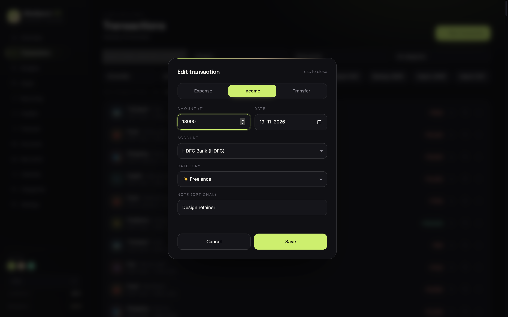
</p>

Every row in the log has **✎ edit**, **⧉ duplicate** and **✕ delete**. Editing opens the same sheet
already filled in, so a wrong category or amount is a two-click fix. Delete asks once (*Sure?*) and then
offers **Undo** for six seconds, because a mis-tap should never cost a record.

### Find anything

<p align="center">
  
</p>

Search by note, amount, category or account while you type. Narrow it by type, account, category, month
or a date range, then sort newest, oldest, highest or lowest. The strip above the list always shows how
many transactions are in view and their net — transfers are excluded, as they always are.

### Budgets

<p align="center">
  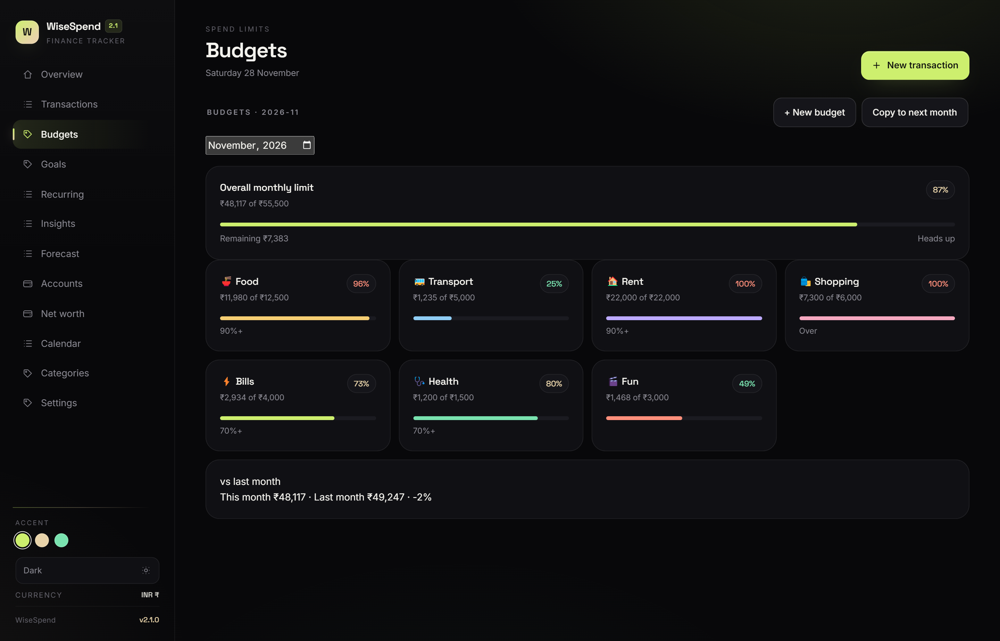
</p>

Set one overall monthly limit and a limit per category. Each bar shows what is spent, what is left and
whether you have gone over. **Copy to next month** repeats the plan, and a comparison against last
month shows the direction of travel.

### Savings goals

<p align="center">
  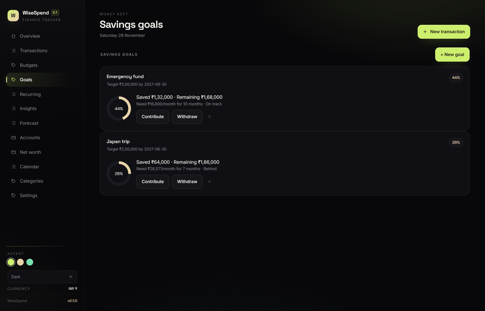
</p>

Give a goal a target, a date and what you have already saved. The ring shows progress; the line below
shows the amount needed per month and whether you are **On track** or **Behind** for the date you chose.
**Contribute** and **Withdraw** move real money: the goal updates and a matching expense or income is
added to the account you pick.

### Recurring and subscriptions

<p align="center">
  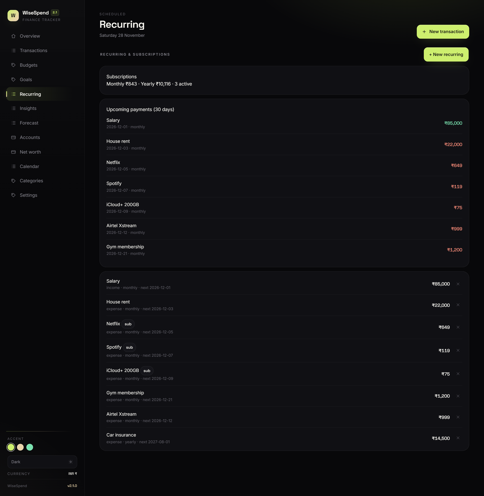
</p>

Salaries, rent, bills and subscriptions with a daily, weekly, monthly, quarterly or yearly cadence.
Subscription totals are normalised to a month and a year, and the next 30 days of payments are listed
in date order so nothing sneaks up on you.

### Insights

<p align="center">
  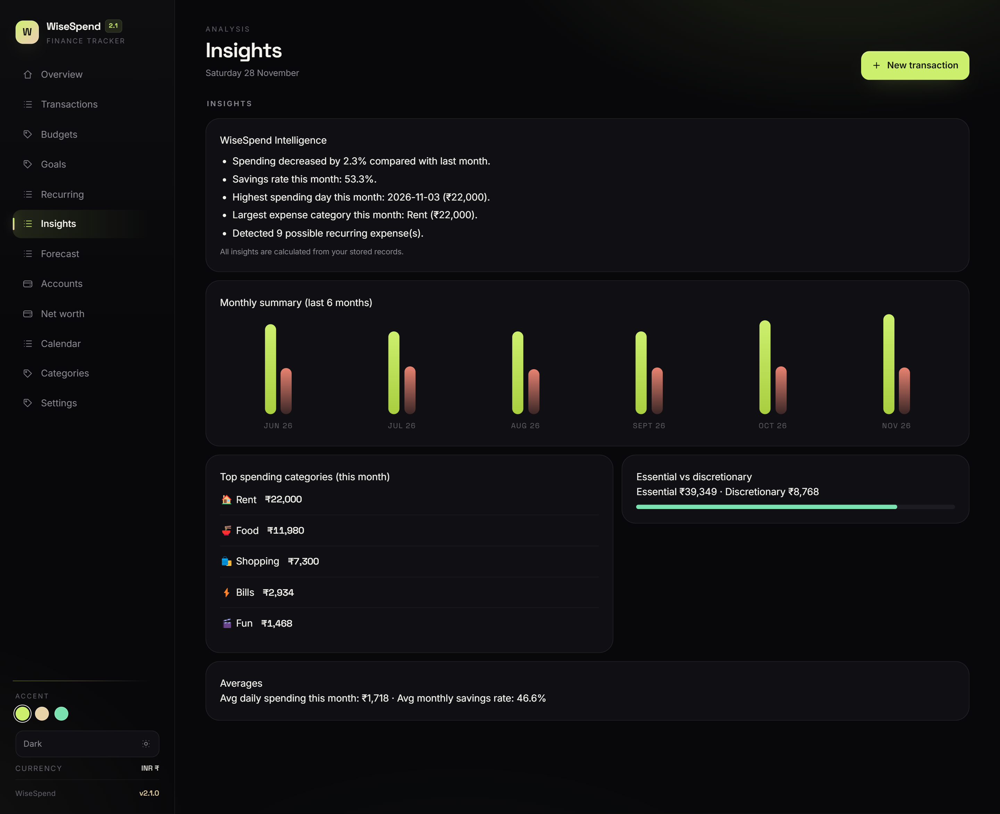
</p>

WiseSpend Intelligence reads your records and states the facts in plain language: spending against last
month, savings rate, the most expensive day, the largest category, and repeated charges it thinks are
recurring. Below it: six months of income against spending, the top categories, and the split between
essential and discretionary spending (mark categories as essential in Settings).

### Forecast

<p align="center">
  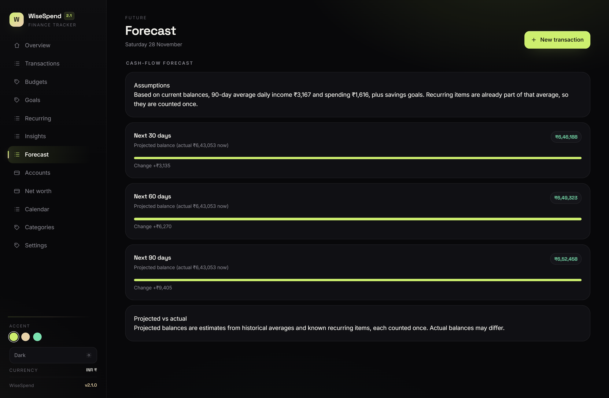
</p>

A 30, 60 and 90-day projection from your current balance, the last 90 days of daily income and spending,
and what your goals ask for each month. Recurring payments are already inside that history, so they are
counted exactly once — adding the schedule again would make every projection too pessimistic.

### Net worth

<p align="center">
  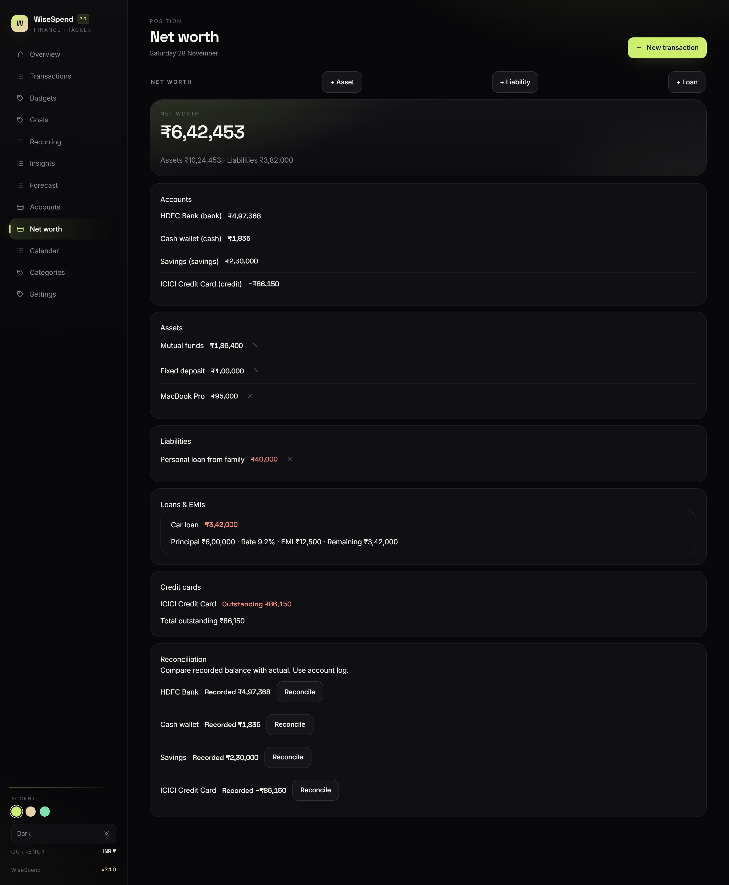
</p>

Accounts plus assets, minus liabilities and loan balances, in one figure. Loans keep their principal,
rate, EMI and remaining balance; credit cards show what is outstanding; **Reconcile** records the
difference when the real balance and the app disagree.

### Calendar and reminders

<p align="center">
  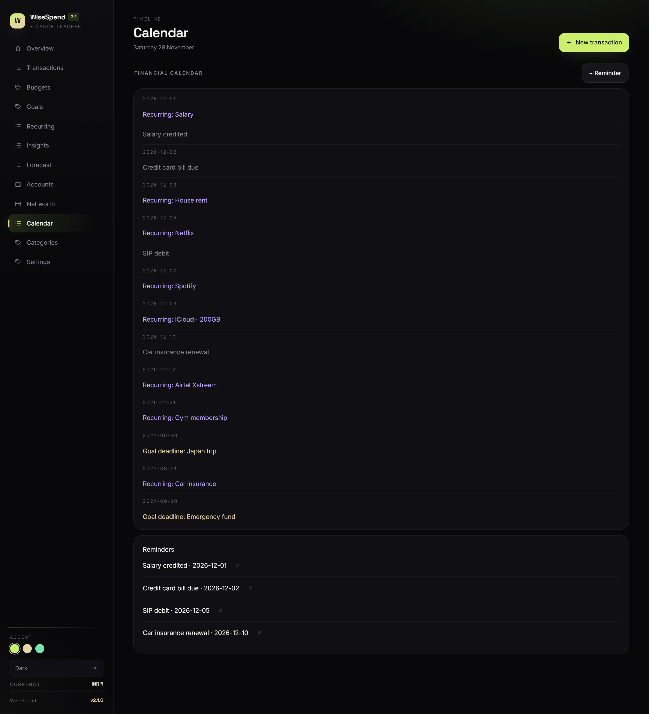
</p>

One timeline of what is coming: recurring payments, goal deadlines and the reminders you add yourself.

### Settings and personalisation

<p align="center">
  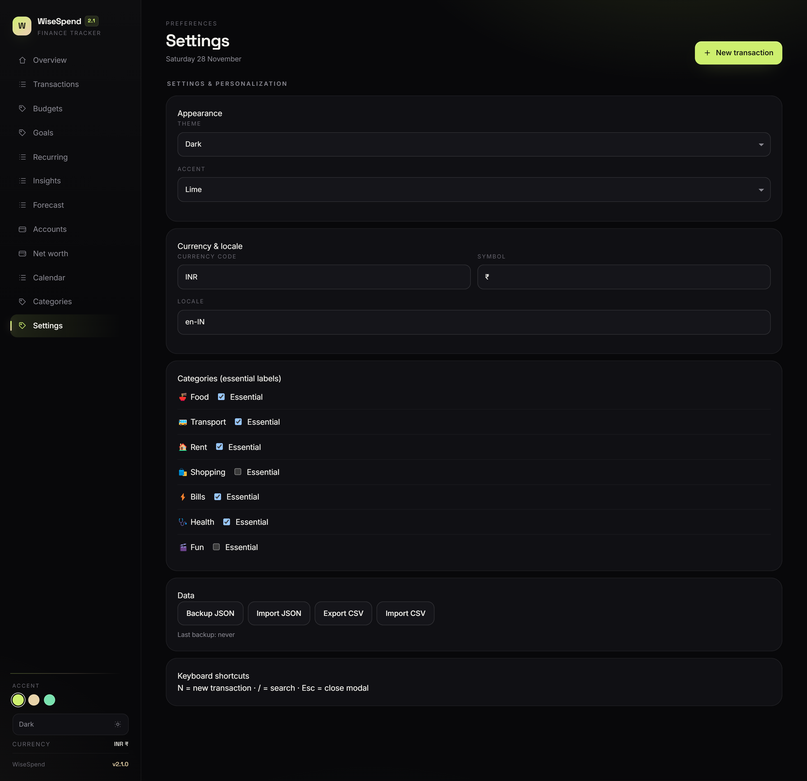
</p>

Dark or light, lime / gold / jade accent, currency code, symbol and locale, essential labels for the
insights split, and all the data tools in one place.

### The basics, unchanged

<p align="center">
  
</p>

<p align="center"><sub><b>Add transaction</b> — Expense, Income or Transfer in one focused sheet. <b>N</b> opens it anywhere.</sub></p>

<p align="center">
  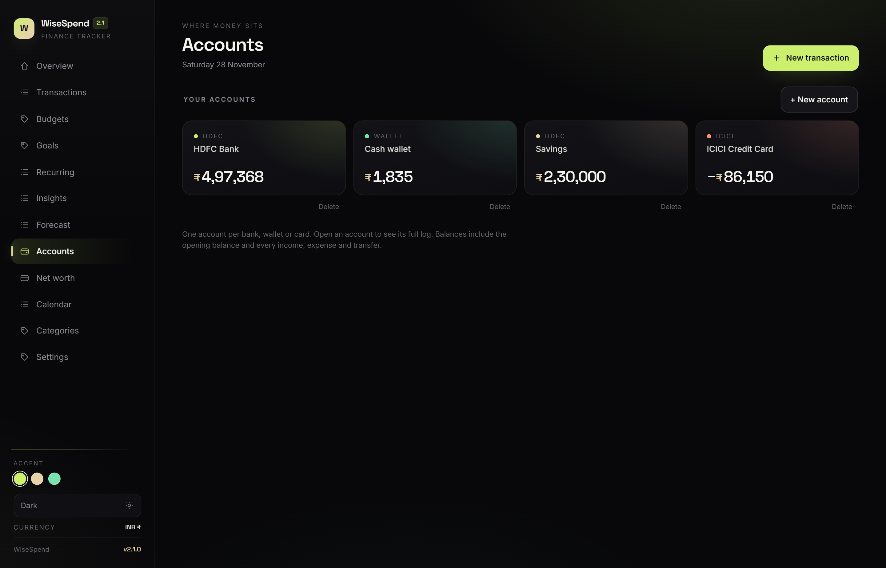
</p>

<p align="center"><sub><b>Accounts</b> — one card per bank, wallet or card, each with its own accent and balance.</sub></p>

<p align="center">
  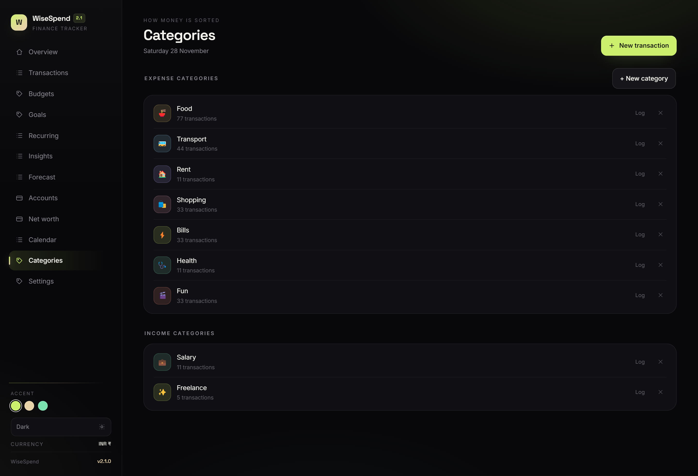
</p>

<p align="center"><sub><b>Categories</b> — expense and income categories with emoji and colour, each with its own log.</sub></p>

### Your data, and getting it out

- **Backup JSON** writes the whole store to a file; **Import JSON** merges it back, skipping anything
  already there by id.
- **Export CSV** and **Import CSV** move transactions in and out of spreadsheets. Rows that are already
  present are not imported twice.
- Every save keeps a rotating local snapshot — the last five — so a bad import or a wrong delete is
  recoverable.
- All of it is local. There is no account, no sync and no network call.

## Design system

WiseSpend is built from a small, fixed set of tokens. Nothing in the app uses a colour outside this list.

### Colour

| Token | Value | Used for |
|---|---|---|
| Main background | `#08080A` | App canvas |
| Soft background | `#0B0B0E` | Recessed areas, light-theme hints |
| Surface · primary | `#101014` | Cards and panels |
| Surface · secondary | `#15151A` | Inputs, filter chips, hovered rows |
| Surface · raised | `#1B1B21` | Tracks, pressed states, badges |
| Border · subtle | `rgba(255,255,255,.075)` | Card and section borders |
| Border · strong | `rgba(255,255,255,.14)` | Inputs, buttons, sheet edge |
| Text · primary | `#F4F3EE` | Headings and amounts |
| Text · secondary | `#D6D5CE` | Row titles, secondary figures |
| Text · muted | `#8B8A93` | Labels, navigation, captions |
| Text · faint | `#65646D` | Metadata, timestamps, emoji-free hints |
| Lime · primary | `#CDEF6E` | Primary buttons, active navigation, focus, highlights |
| Lime · deep | `#A9CE3F` | Gradient end of lime fills and bars |
| Jade | `#79E2AF` | Income, positive values |
| Coral | `#FF8F7B` | Expenses, destructive actions, errors |
| Lilac | `#BCA9FF` | Transfers |
| Amber | `#F5CE73` | Category accent |
| Sky | `#8FCDF5` | Category accent |
| Rose | `#F5A8C0` | Category accent |
| Champagne gold · heritage | `#E8D3A9` | Savings, goals, brand gradient, legacy accent |
| Text on lime | `#0A0A0B` | Labels on primary buttons |

Colour is never decorative: jade always means money in, coral always means money out, lilac always means
a transfer, and gold always means money kept.

### Typography

| Role | Font | Weights | Notes |
|---|---|---|---|
| Display | **Space Grotesk** | 400 / 500 / 600 / 700 | Page headings, balances, statistics, account figures, amounts |
| Body | **Inter** | 400 / 500 / 600 | Navigation, labels, notes, inputs |

- Page heading: Space Grotesk 600, 30px, `-0.028em`.
- Hero balance: Space Grotesk 600, 58px, `-0.035em`, tabular figures, small muted `₹` prefix.
- Statistics and KPI values: Space Grotesk 500, 20px, tabular figures.
- Eyebrow labels: Inter 600, 10px, `0.19em`, uppercase, faint.

### Shape, depth and motion

- Radii: `26px` hero, `20px` cards, `16px` account and icon tiles, `11px` inputs.
- One-pixel borders at 7.5% white; elevation comes from surface contrast, not heavy shadows.
- Hero has a lime-to-gold hairline along its top edge and two restrained radial washes (lime top-left, gold bottom-right).
- Transitions are 160–180ms; hover lifts cards by 2px; charts animate width/height over 400ms.

### The gold thread

1.x was champagne gold on black. 2.x keeps that identity as a second voice rather than dropping it:
the brand mark is a lime-to-gold gradient, the hero hairline fades lime into gold, the savings KPI is
rendered in gold, goal rings are gold, the Savings account glows gold, and the accent switch still offers
**Gold** (champagne) alongside **Lime** and **Jade**.

## What it does

- **Overview** — total balance, this month's income / spent / saved, account cards, six-month money-in-and-out chart, spending by category, recent transactions
- **Transactions** — search and filters, four sort orders, running net, edit, duplicate, delete with undo
- **Accounts** — one per bank, wallet or card, each with an opening balance, colour and full log
- **Categories** — custom expense and income categories with emoji and colour, each with its own log
- **Budgets** — monthly overall and per-category limits with progress, copy-forward and last-month comparison
- **Goals** — savings targets with progress rings, monthly requirement and on-track state
- **Recurring** — scheduled income and expenses, subscription totals, next 30 days
- **Insights** — plain-language findings, six-month chart, top categories, essential vs discretionary
- **Forecast** — 30, 60 and 90-day projected balance
- **Net worth** — assets, liabilities, loans, credit card outstanding and reconciliation
- **Calendar** — recurring payments, goal deadlines and reminders
- **Settings** — theme, accent, currency, locale, essential labels, backup / export / import
- **Keyboard** — `N` new transaction, `/` search, `Esc` close

Balance of an account = opening balance + income − expenses − transfers out + transfers in.

## Upgrading from Sable or WiseSpend 2.0

WiseSpend used to be Sable, and renaming an Electron app moves the folder it keeps its data in
(`%APPDATA%/Sable` on Windows, `~/Library/Application Support/Sable` on macOS). 2.0.1 and later handle it:
on the first launch, WiseSpend reads the Sable store through a throwaway profile and adopts it.

- A fresh WiseSpend profile is **replaced** with your Sable accounts, categories, transactions and accent.
- A profile that already has entries is **merged** by id, so nothing is duplicated and nothing is deleted.
- The imported store is staged as `sable-recovered.json` in the WiseSpend data folder and removed once
  the app has adopted it; a `.legacy-store-checked` marker makes the migration a one-time step.
- That marker is only written after a successful import, or when there is no Sable profile to read. If the
  old store cannot be read (Sable still running, for example), the next launch tries again.
- The 1.x champagne accent preference carries over as the **Gold** accent.
- On launch the Overview shows a one-time "Recovered from Sable" note with what was carried over.
- Your Sable installation is left untouched — uninstall it once you have checked that your numbers are there.

**From 2.0.3 to 2.1** there is nothing to do. Budgets, goals, recurring items, reminders, loans, assets
and liabilities are new lists added next to your existing data; accounts, categories, transactions and
preferences are read exactly as 2.0 wrote them.

## Download

Go to **[Releases](../../releases/latest)** and pick your file:

| Platform | File |
|---|---|
| Windows | `WiseSpend-Setup-<version>.exe` |
| Mac (Apple Silicon) | `WiseSpend-<version>-arm64.dmg` |
| Mac (Intel) | `WiseSpend-<version>-x64.dmg` |

The installers are not code-signed, so Windows and Mac show a warning the first time:

- **Windows:** "Windows protected your PC" → *More info* → *Run anyway*
- **Mac:** right-click the app → *Open* → *Open*, or in Terminal: `xattr -cr /Applications/WiseSpend.app`

## Run it yourself

Requires [Node.js](https://nodejs.org).

```
npm install
npm start
```

If Electron's installer script is blocked during `npm install`, run:

```
node node_modules/electron/install.js
npm start
```

## Tests

The money maths lives in `calc.js` and is covered by Node's built-in test runner — no extra dependencies:

```
npm test
```

18 tests cover account balances, transfers not changing the total, monthly totals, category spending,
budget progress, goal pace, recurring cadence, the forecast (including recurring payments being counted
once) and net worth. The app and the tests run the same file, so a test can never pass against a copy
that drifted from what ships.

## Build an installer

```
npm run dist:win     # Windows .exe
npm run dist:mac     # Mac .dmg (must be run on a Mac)
```

If Windows complains about symbolic links while building, turn on **Developer Mode**
(Settings → System → For developers) and retry.

## Releasing a new version

1. Change `"version"` in `package.json` (e.g. `2.2.0`) and the version in `index.html`.
2. Create a GitHub Release with tag `v2.2.0`.
3. The workflow in `.github/workflows/release.yml` builds the installers and attaches them automatically.

Repo setting needed once: **Settings → Actions → General → Workflow permissions → Read and write permissions**.

## What changed

### 2.1.0

- **Edit, duplicate and delete transactions.** The edit sheet opens filled in; duplicates keep every
  field and take today's date; deletes ask once and offer a six-second Undo.
- **Search and filters** across notes, amounts, categories and accounts, with type / account / category /
  month / date-range filters, four sort orders and a running count and net.
- **CSV export and import** and **JSON backup and restore**, both with duplicate detection, plus five
  rotating local snapshots that every save writes.
- **Budgets** — an overall monthly limit and per-category limits, with progress, over-budget states,
  copy-to-next-month and a last-month comparison.
- **Savings goals** — target, date, gold progress ring, required monthly amount, on-track state, and
  contribute / withdraw that writes a matching transaction.
- **Recurring payments and subscriptions** — five cadences, subscription totals per month and year, and
  the next 30 days of scheduled payments.
- **Insights** — WiseSpend Intelligence findings, a six-month income/spending chart, top categories and
  an essential-vs-discretionary split.
- **Forecast** — 30, 60 and 90-day projected balance from the last 90 days plus goal requirements.
  Recurring payments are counted once: they are already inside the historical average.
- **Net worth** — accounts, assets, liabilities, loans and credit card outstanding, with per-account
  reconciliation.
- **Calendar** — recurring payments, goal deadlines and personal reminders in one timeline.
- **Settings** — theme, accent, currency, symbol and locale, essential category labels, and the data tools.
- **Keyboard shortcuts** — `N`, `/` and `Esc`.
- Version is now 2.1.0 in the app, the window title, the installers and the sidebar.

### 2.0.3

- A Sable store that is locked or otherwise unreadable (for example because Sable is still running) is no longer
  written off: the import is retried on the next launch instead of being marked as checked.
- The staged `sable-recovered.json` copy is removed once the app has adopted it.

### 2.0.2

- Fixed the **Got it** button on the recovery banner, which did nothing, so the note could not be dismissed.

### 2.0.1

- The app is now **WiseSpend** in name as well as design: `com.wisespend.finance`, `WiseSpend-Setup-*.exe`,
  `WiseSpend-*.dmg`, and the repository is `innovation-workslmt/WiseSpend`.
- The version is visible in the app at the foot of the sidebar, and the window and installers report the
  same build.
- **Fixed the broken upgrade.** Sable's data folder is read on first launch and adopted or merged, so upgrading no
  longer looks like an empty app (see *Upgrading from Sable*).
- More of the original gold: the remembered currency symbol on balances, the active navigation bar, the divider
  above the sidebar settings, the current month on the money flow chart and the sheet edge all pick up champagne.

### 2.0.0

- Complete visual redesign to the WiseSpend design language: black canvas, lime accent, Space Grotesk display type, 26/20px radii, hairline borders, tabular financial figures.
- New brand mark, app icon and wordmark (lime-to-gold gradient) replacing the gold "S".
- New six-month money flow chart on the Overview, plus a savings rate chip on spending.
- Semantic colour across the app: jade income, coral expenses, lilac transfers, gold savings.
- The champagne gold of 1.x is preserved as a secondary accent and remains selectable as an app accent.
- Existing data is kept: the app reads the old `sable-v1` store and migrates it to `wisespend-v2`.

## How it is built

One `index.html` with inline CSS and vanilla JavaScript, wrapped in Electron by `main.js`.
No framework, no build step, no server. The money maths is a separate plain-JS module so it can be tested.

```
WiseSpend/
├── .github/workflows/release.yml
├── assets/          icon, wordmark and the screenshots above
├── calc.js          balances, budgets, goals, recurring, forecast, net worth
├── index.html       the entire app
├── legacy-read.html blank page used to read an old Sable profile
├── main.js          Electron window + the Sable upgrade path
├── preload.js       hands the staged Sable store to the app
├── test/            node:test suites for calc.js
├── package.json     app + installer config
└── README.md
```

## Roadmap

Not in 2.1, and not promised:

- Multi-currency accounts with exchange rates
- An app lock (PIN or system auth)
- Reordering Overview cards
- Desktop notifications for reminders

## License

MIT
